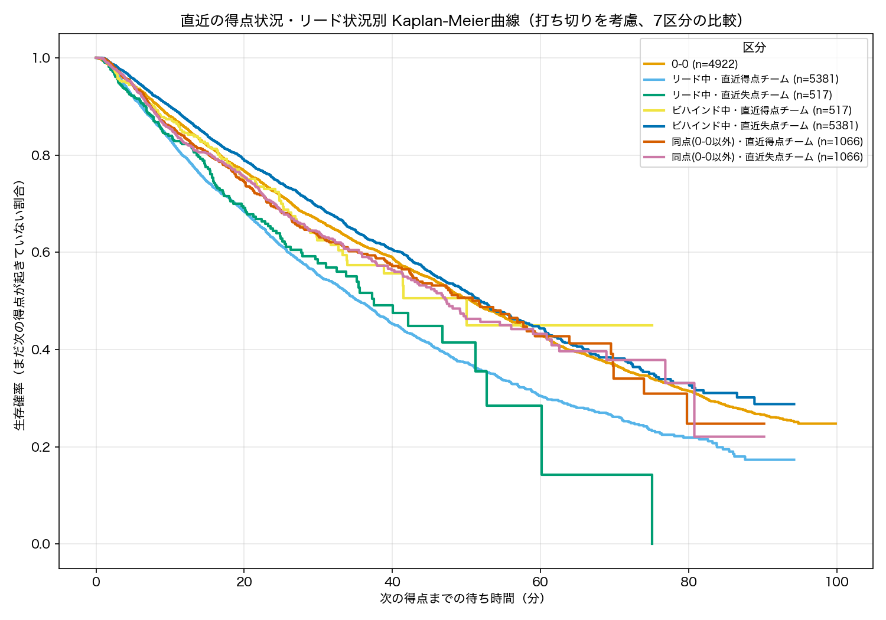
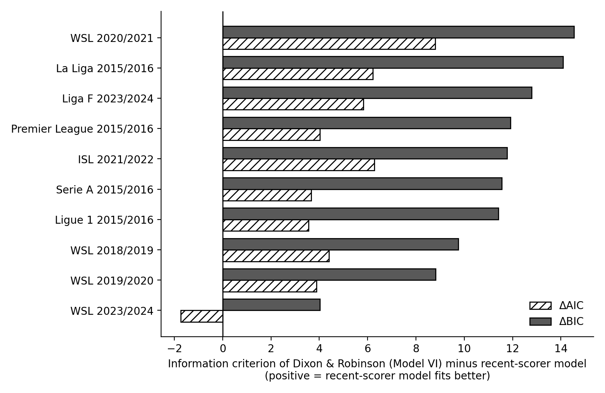

# Soccer_Score_Progression_Analysis

　サッカーの試合中のスコアの推移を確率モデルで表し、*Dixon&Robinson* (1998)モデルの改善を目指す修士研究のリポジトリ。

## 研究の目的
　*Dixon&Robinson* (1998)モデルは、試合中のスコアの遷移に二変量の出生過程を仮定し、
0-0、1-0のようなスコア状況ごとに得点のハザードを変化させることで、得点の推移を表現している。

　本研究の目的は、このモデルの改善である。
StatsBombのイベントデータを用いて得点間の待ち時間を経験的に分析し、スコア状況の区分以外にハザードに影響する特徴を抽出する。
抽出した特徴をモデルに組み込み、元のモデルとAIC・BICで比較する。

## 研究の流れ
1. **Empirical_Analysis**：得点間の待ち時間や我々の設定したカテゴリーごとの得点数などを分析し、ハザード、得点の起こりやすさに影響する特徴を探す。
2. **Models**：見つけた特徴をハザードに組み込んだモデルや新しい形の確立過程モデルを作り、*Dixon&Robinson* (1998)モデルと比較する。

## 主な結果（途中経過）
　現時点で分かっていることをまとめる。研究は進行中のため、今後変わる可能性がある。

### 1. 状態によって、次の得点までの待ち時間の分布が違う
　「リード・同点・ビハインド」×「直前に得点したのは自チームか相手か」の7区分で、次の得点までの待ち時間をKaplan-Meier曲線で比べた。
区分ごとに曲線の形が違い、スコア差だけでなく直前の得点の状況もハザードに関係しそうなことが分かる。
この結果をもとに、*Dixon&Robinson* (1998)モデルのスコア状況の区分を7区分に置き換えた「直近得点者モデル」を作った。



### 2. 直近得点者モデルは、元のモデルよりAIC・BICが小さい
　StatsBombの11のリーグ・シーズンで、*Dixon&Robinson* (1998)のモデルVIと直近得点者モデルを同じデータに当てはめて比べた。
Frauen Bundesliga 2023/24は、モデルVIの推定で得点強度が負になる試合が残り、AIC・BICが信頼できないため除いた。残りの10では次のようになった。

- BICは、**10すべてで直近得点者モデルのほうが小さい**（差は4.0〜14.5）。
- AICは、**10のうち9で直近得点者モデルのほうが小さい**（差は3.6〜8.8）。FA Women's Super League 2023/24だけは、モデルVIが1.7小さい。
- 直近得点者モデルのほうがパラメータが2個少ない（スコア状況の倍率をホームとアウェイで共有しているため）。BICの差には、この分も含まれている。



詳しい数値は `Models/dixon_robinson_pure_results/summary_all.csv` と `Models/recent_scorer_results/summary_all.csv` にある。

## リポジトリ構成
```
Soccer_Score_Progression_Analysis/
├── README.md
├── DATAAVAILABILITY.md       # 使用データ（StatsBomb Open Data）について
├── Empirical_Analysis/       # 得点間の待ち時間の経験的分析
│   ├── Skill_Gap/            # 実力差による違い
│   ├── Match_Status/         # 試合状況（スコア・直近の得点者）による違い
│   ├── Time_Zone/            # 時間帯による違い
│   └── League_Progress/      # リーグの進捗率（シーズンの序盤・中盤・終盤）による違い
└── Models/                   # 確率モデルの実装と推定
```

## Empirical_Analysis
　得点間の待ち時間に影響を与える要因を、**実力差**・**試合状況**・**時間帯**・**リーグの進捗**の4つに分けて分析する。
詳細は [Empirical_Analysis/README.md](Empirical_Analysis/README.md) を参照。

- **Skill_Gap（実力差）**：両チームの実力差によって、次の得点までの待ち時間がどう変わるかを分析する。
- **Match_Status（試合状況）**：スコア差や直前に得点したチーム、レッドカードの有無など、試合状況によって次の得点までの待ち時間がどう変わるかを分析する。
- **Time_Zone（時間帯）**：試合の時間帯によって得点の起こりやすさがどう変わるかを分析する。
- **League_Progress（リーグの進捗）**：シーズンの進み具合（進捗率）によって、得点の起こりやすさがどう変わるかを分析する。

## Models
　**Empirical_Analysis** で抽出した特徴をハザードに組み込み、*Dixon&Robinson* (1998)モデルと比較する。
詳細は [Models/README.md](Models/README.md) を参照。

## データ
　[StatsBomb Open Data](https://github.com/statsbomb/open-data) の以下の大会・シーズンを使用している。
データ本体はリポジトリに含めていない。詳細とクレジットは [DATAAVAILABILITY.md](DATAAVAILABILITY.md) を参照。

- 男子：Premier League、La Liga、Serie A、Ligue 1（いずれも2015/16）、Indian Super League 2021/22
- 女子：FA Women's Super League（2018/19、2019/20、2020/21、2023/24）、Liga F 2023/24、Frauen-Bundesliga 2023/24

## 参考文献
- Maher, M. J. (1982). Modelling association football scores. *Statistica Neerlandica*, 36(3), 109–118.
- Dixon, M. J. and Coles, S. G. (1997). Modelling association football scores and inefficiencies in the football betting market. *Journal of the Royal Statistical Society: Series C (Applied Statistics)*, 46(2), 265–280.
- Dixon, M. J. and Robinson, M. E. (1998). A birth process model for association football matches. *Journal of the Royal Statistical Society: Series D (The Statistician)*, 47(3), 523–538.
- Rue, H. and Salvesen, Ø. (2000). Prediction and retrospective analysis of soccer matches in a league. *Journal of the Royal Statistical Society: Series D (The Statistician)*, 49(3), 399–418.
- Karlis, D. and Ntzoufras, I. (2005). Bivariate Poisson and diagonal inflated bivariate Poisson regression models in R. *Journal of Statistical Software*, 14(10), 1–36.
- Volf, P. (2009). A random point process model for the score in sport matches. *IMA Journal of Management Mathematics*, 20, 121–131.
- Boshnakov, G., Kharrat, T. and McHale, I. G. (2017). A bivariate Weibull count model for forecasting association football scores. *International Journal of Forecasting*, 33(2), 458–466.
- Zou, Q., Li, Q., Guo, H. and Shi, J. (2018). A discrete-time and finite-state Markov chain model for association football matches. *Communications in Statistics - Simulation and Computation*, 47, 2476–2485.
- Zou, Q., Song, K. and Shi, J. (2020). A Bayesian in-play prediction model for association football outcomes. *Applied Sciences*, 10(8), 2904.
- Michels, R., Ötting, M. and Karlis, D. (2024). Extending the Dixon and Coles model: an application to women's football data. *Journal of the Royal Statistical Society: Series C (Applied Statistics)*. https://doi.org/10.1093/jrsssc/qlae050
